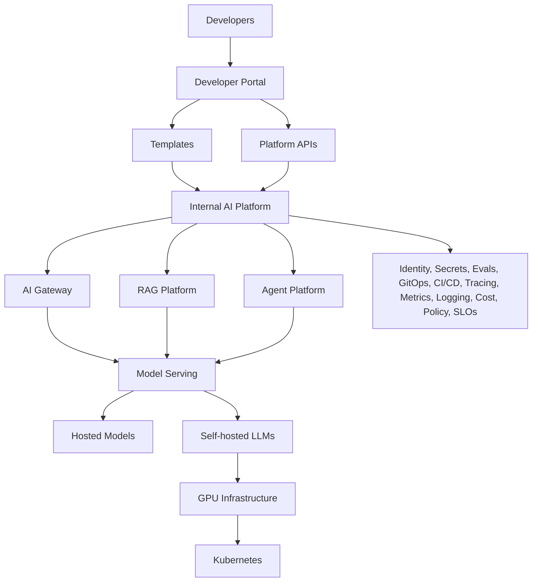

# Course Architecture

## Central Project

The course is organized around a fictional company called Acme AI that is building an internal AI platform for multiple application teams.

## Platform Direction

## Why This Matters

The repository is intentionally not a collection of unrelated tutorials. Every module adds another capability to the same platform story so learners can reason about interfaces, ownership, and production tradeoffs.

## Stage Progression

1. Single application calling a model API
2. AI gateway and model routing
3. RAG as a reusable platform capability
4. Agents, tools, and MCP-aware operations
5. Kubernetes, GPUs, and self-hosted serving
6. Observability, evaluation, and security controls
7. Developer self-service platform experiences