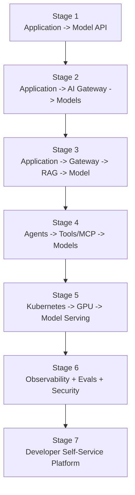
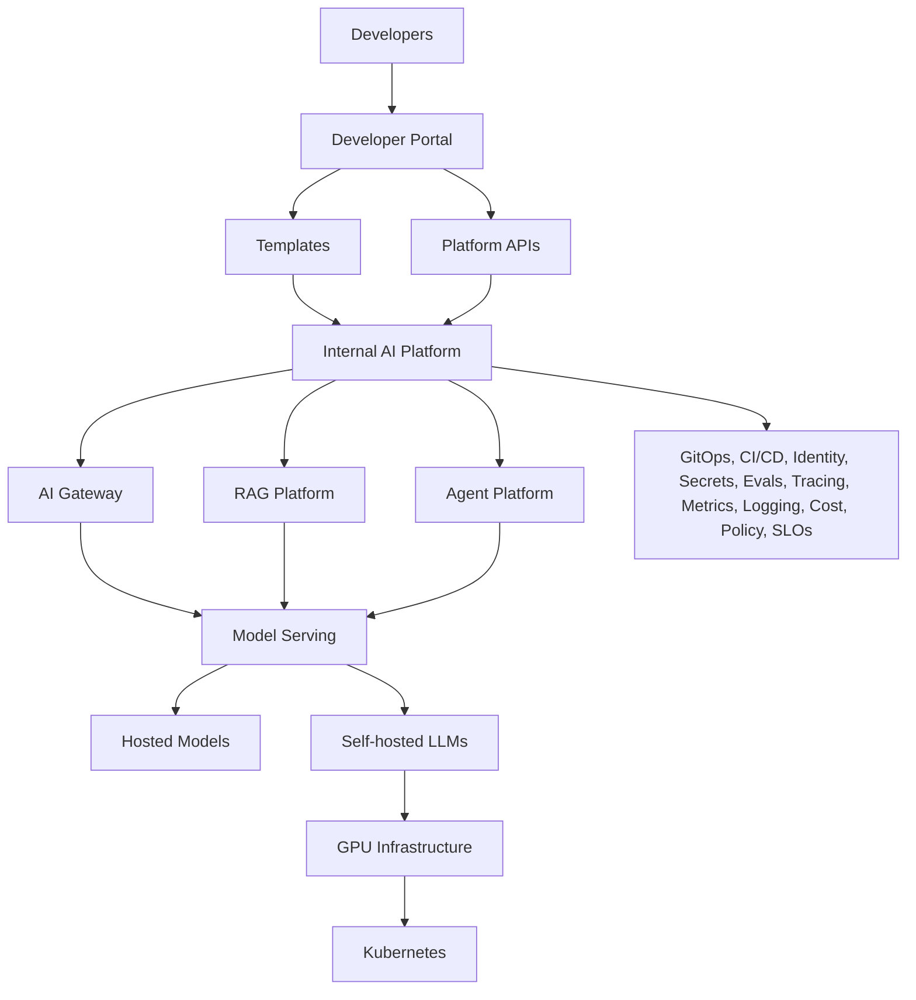
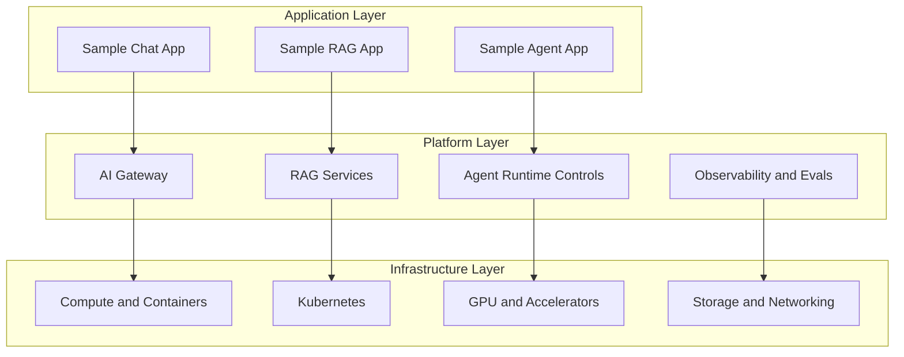

# Module 00 Architecture

## Why Start With Architecture In Module 00

Even before building anything, you need a stable mental model for the platform we are going to grow across the course.

The architecture begins very small and becomes more capable over time.

## Stage Evolution

## Final Platform Direction

## Layer Boundaries

## What Module 00 Covers

Module 00 does not implement this platform yet. It gives you enough orientation to understand where each future capability fits and why the repository structure is being created the way it is.