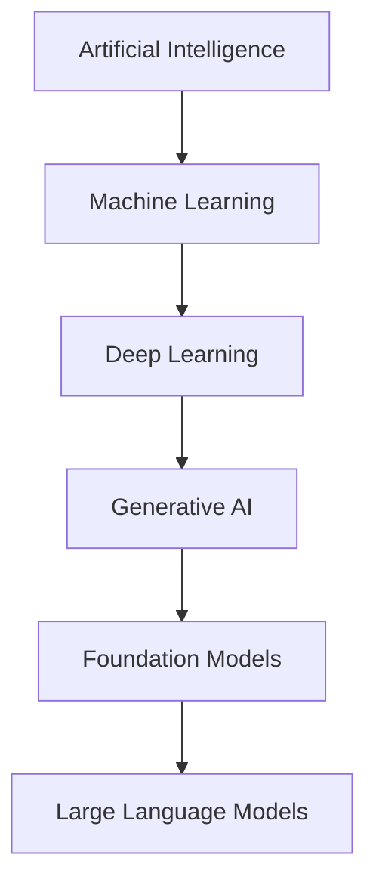
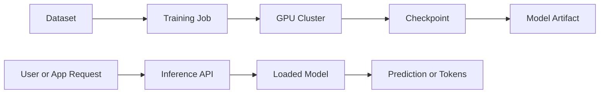
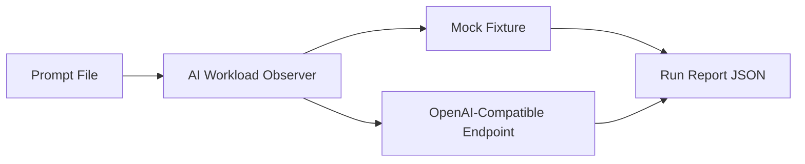
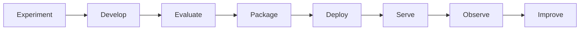

# Module 01 Architecture

## Mental Model Diagrams

This module is conceptual, but it still benefits from architecture views. The purpose of these diagrams is to show the control points a platform engineer should care about before specific tools enter the picture.

## AI Domain Relationship

## Training And Inference As Different Systems

## Mini Project Flow

## Lifecycle View

## What To Notice

- training and inference are adjacent, but not interchangeable workloads
- the inference interface becomes a platform surface as soon as multiple teams or models exist
- observability starts at the first API call, not only after Kubernetes is introduced
- the lifecycle is a control loop, not a one-way pipeline