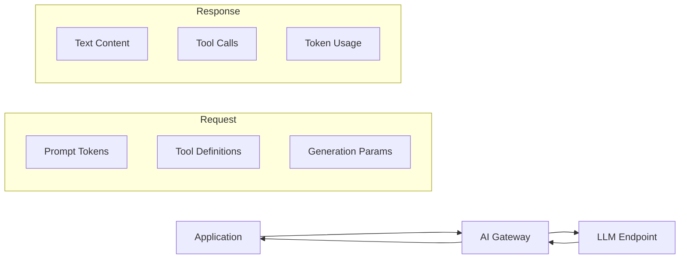
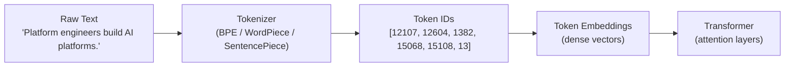
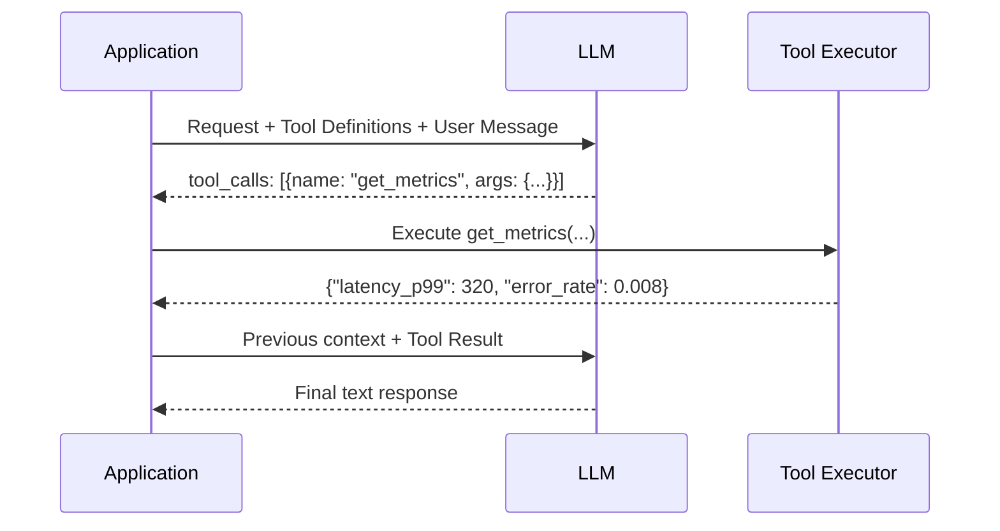
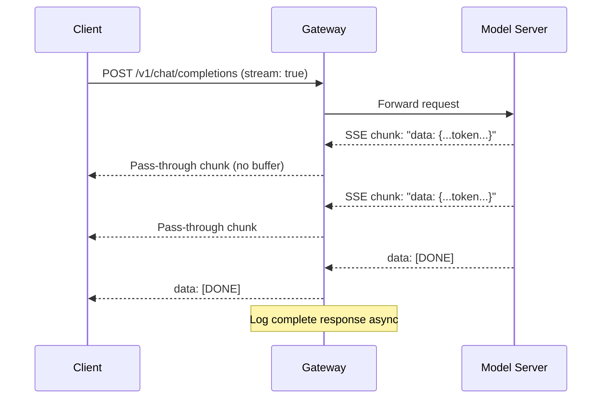
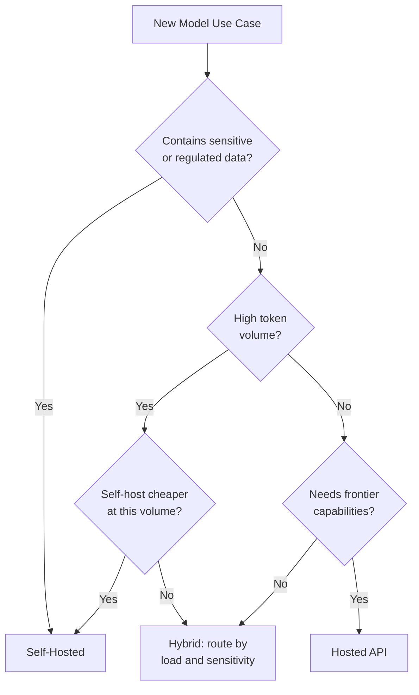

# Module 02 Architecture

## The LLM Request Path



## Tokenization Flow



## Context Window Composition

```
┌─────────────────────────────────────────────────────────┐
│                   Context Window                        │
│  Max: 128,000 tokens                                    │
├──────────────────┬──────────────────┬───────────────────┤
│  System Prompt   │  Retrieved Docs  │  Conversation     │
│  ~600 tokens     │  ~2,000 tokens   │  History          │
│                  │                  │  ~500 tokens       │
├──────────────────┴──────────────────┴───────────────────┤
│  User Turn: ~100 tokens                                 │
├─────────────────────────────────────────────────────────┤
│  Output Reserve: ~500 tokens                            │
└─────────────────────────────────────────────────────────┘
```

## Tool Calling Loop



## Streaming Response Path



## Hosted vs Self-Hosted Decision Model


