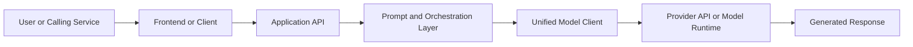
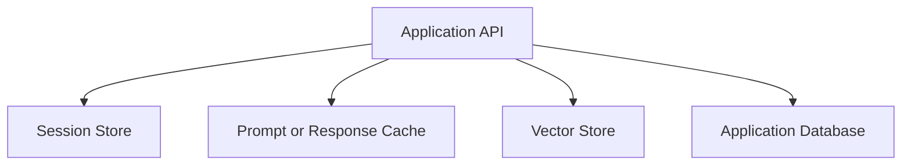
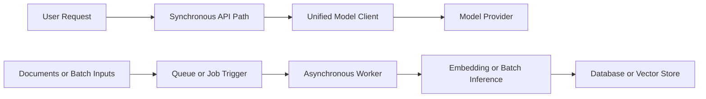
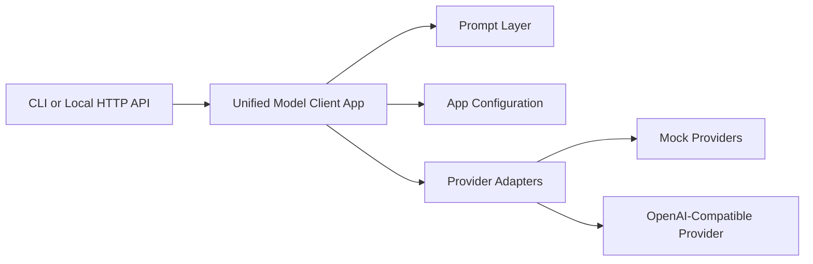

# Module 03 Architecture

## Core Request Path

## Stateful Concerns Around The Request Path

## Synchronous And Asynchronous Split

## Project 01 Application Shape

## What To Notice

- the model call is only one part of the application
- prompt handling and provider transport should not be tightly coupled
- state should live in explicit services, not accidental process memory
- user-facing and background AI work should not share the same operational assumptions