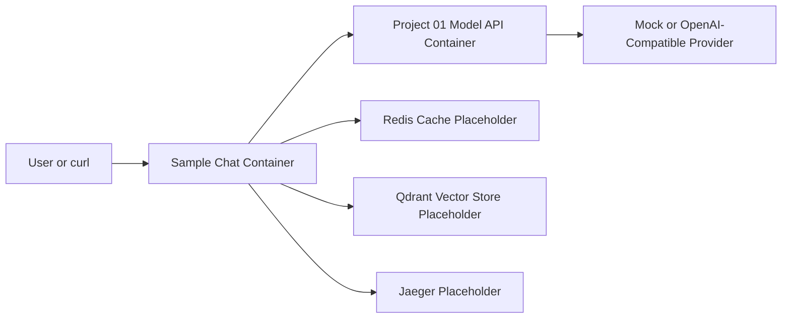
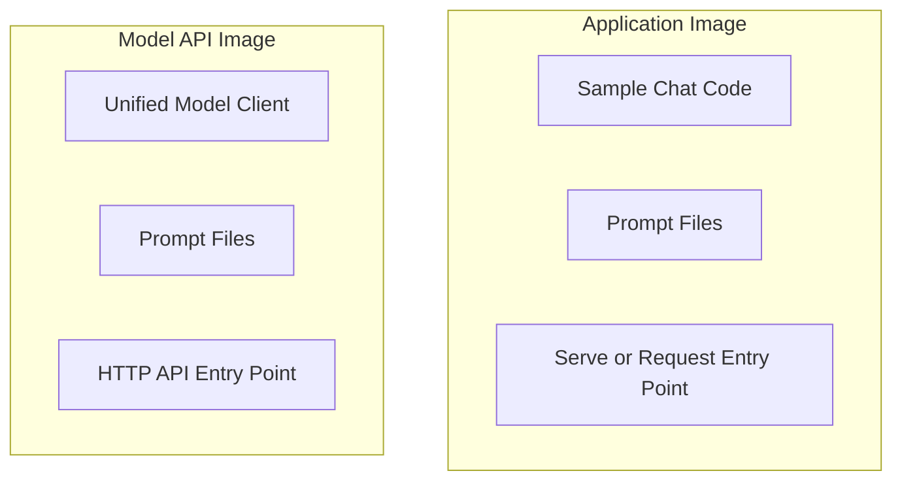
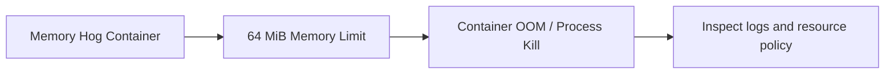

# Module 04 Architecture

## Containerized Local Stack

## Image Boundary View

## OOM Failure Lab

## What To Notice

- the application and model-access layers are networked services, not one process
- resource policies belong to the service definition, not only to human memory
- backing services can appear in the local stack even before the application uses every one directly