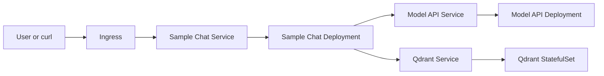
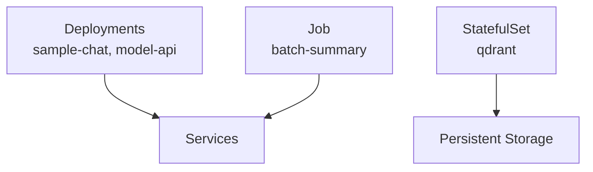
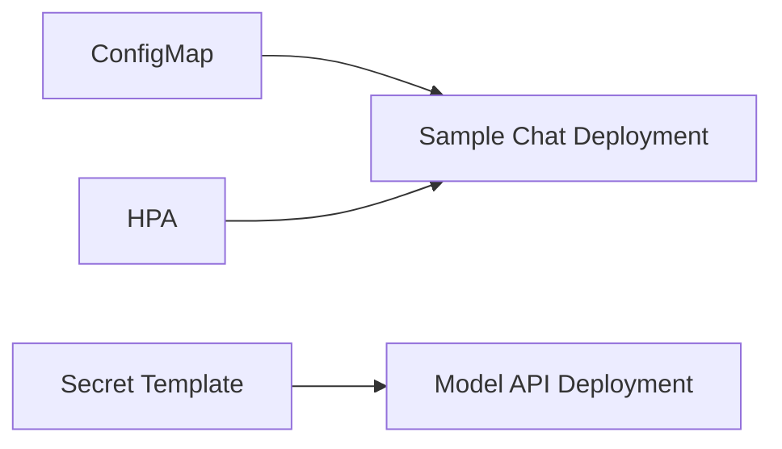

# Module 05 Architecture

## Sample Chat Stack On Kubernetes

## Mixed Workload Types

## Control And Config Objects

## What To Notice

- the application path is still recognizably the same as in Module 04
- Kubernetes adds control over rollout, scaling, and service discovery
- stateful infrastructure is modeled explicitly rather than hidden inside app pods