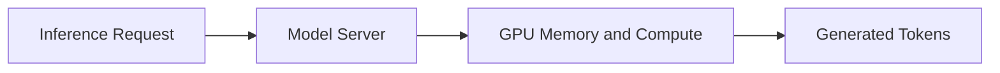
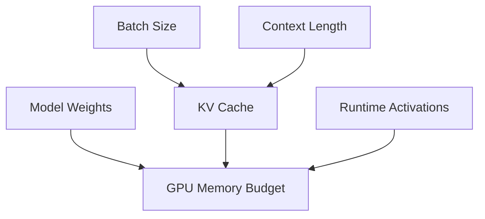
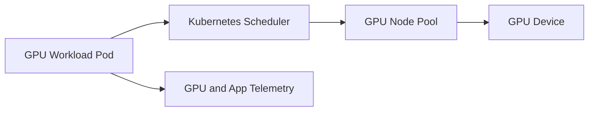

# Module 06 Architecture

## Accelerator-Aware Serving View

## Memory Pressure Model

## Kubernetes GPU Placement View

## What To Notice

- memory pressure is a serving concern, not only a model-training concern
- node pools and scheduling policy become part of application reliability once GPUs appear