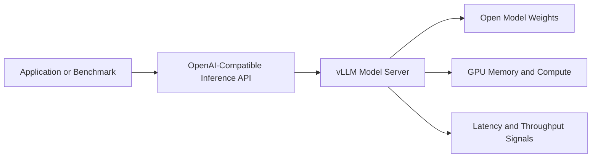
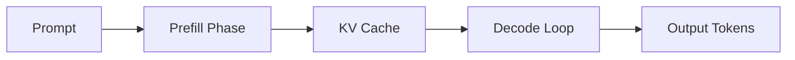
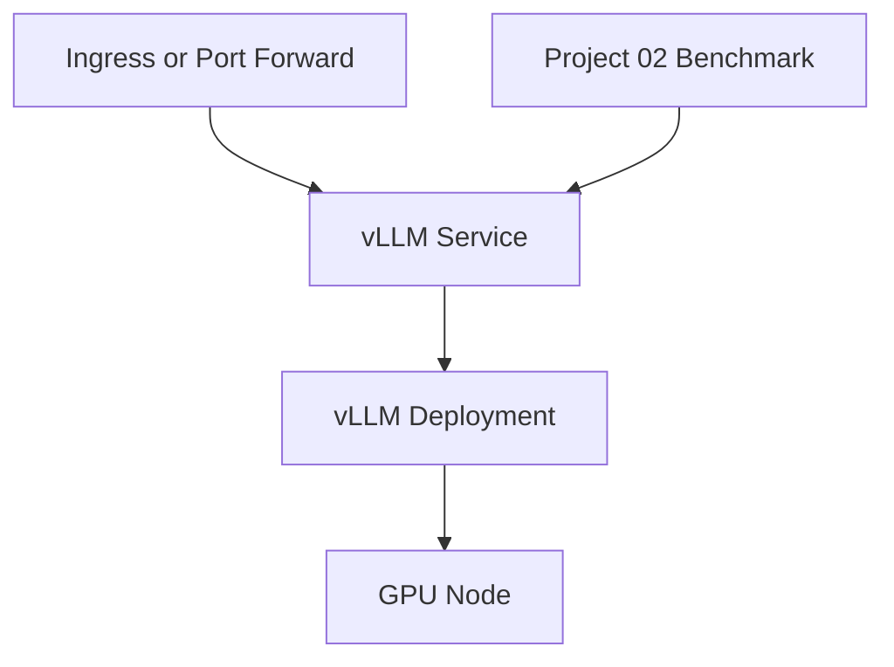

# Module 07 Architecture

## Serving Stack View

## Request Processing View

## Kubernetes View

## What To Notice

- the serving path is a runtime system, not only an API contract
- performance behavior depends on both model properties and serving strategy
- Kubernetes gives deployment structure, but it does not remove the need to understand inference behavior