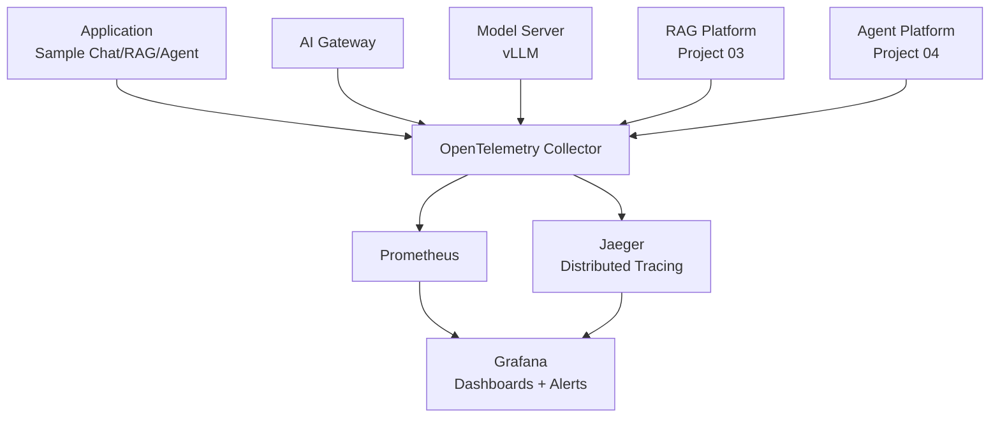
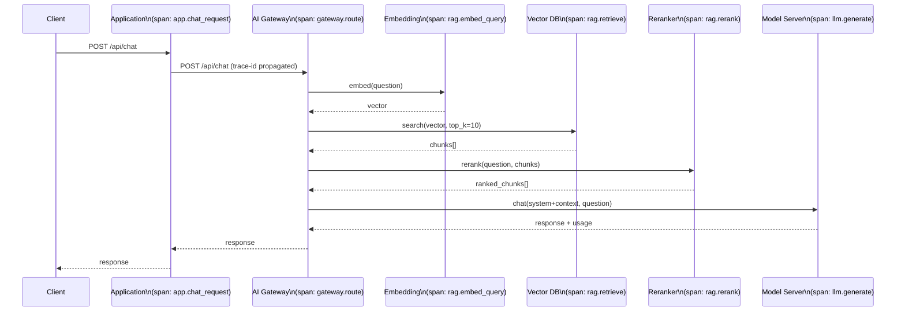
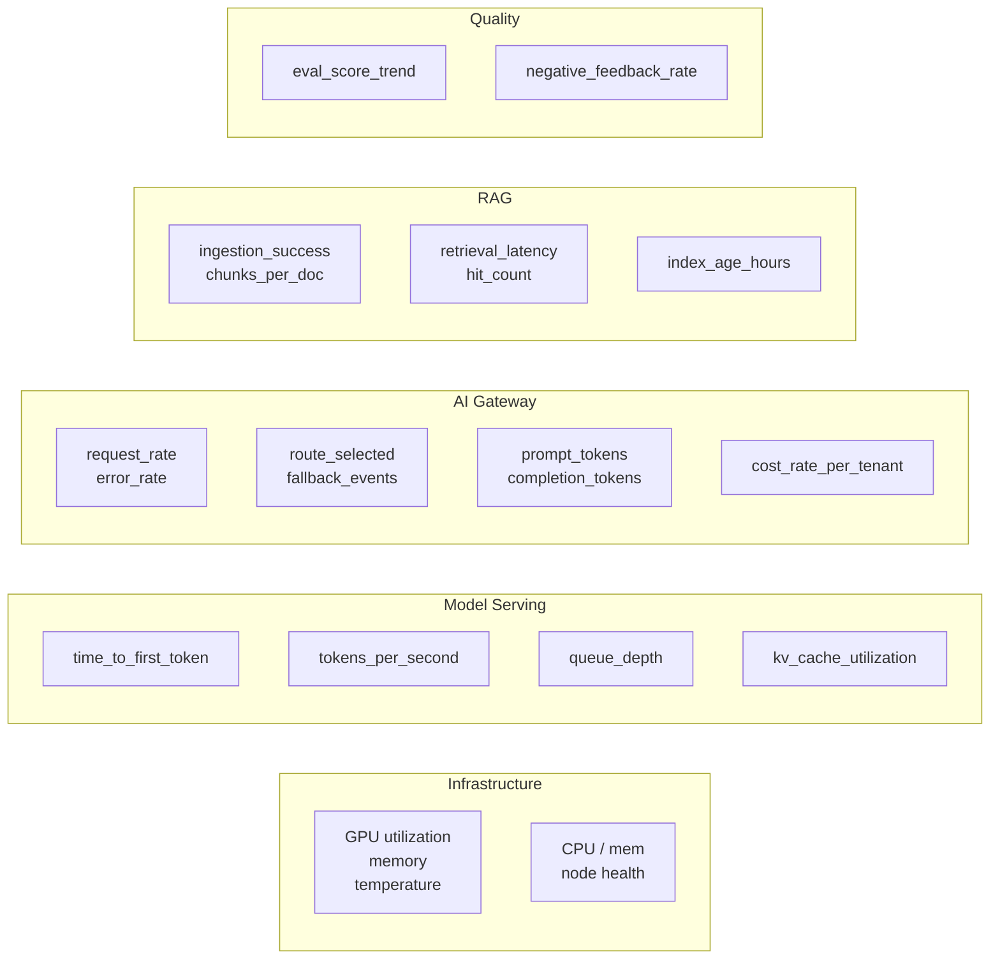

# Module 12 Architecture

## AI Platform Observability Stack



## Distributed Trace: RAG Request



## Metric Layers



## Dashboard Layout

```
┌──────────────────────────────────────────────────────────────────┐
│ Platform Overview                          [time range: 1h / 6h] │
├──────────┬──────────┬──────────┬──────────┬──────────────────────┤
│ Req/min  │ Error %  │ TTFT p50 │ TTFT p95 │  Cost/hr (tokens)   │
│   432    │  0.8%    │  380ms   │  980ms   │     $0.42           │
├──────────┴──────────┴──────────┴──────────┴──────────────────────┤
│ Request Rate (by model)          │ Token Usage (by tenant)        │
│ [time series]                    │ [stacked bar]                  │
├──────────────────────────────────┤────────────────────────────────┤
│ TTFT Distribution (heatmap)      │ RAG Retrieval Latency          │
├──────────────────────────────────┤────────────────────────────────┤
│ GPU Utilization (by node)        │ Eval Score (7-day trend)       │
└──────────────────────────────────┴────────────────────────────────┘
```
