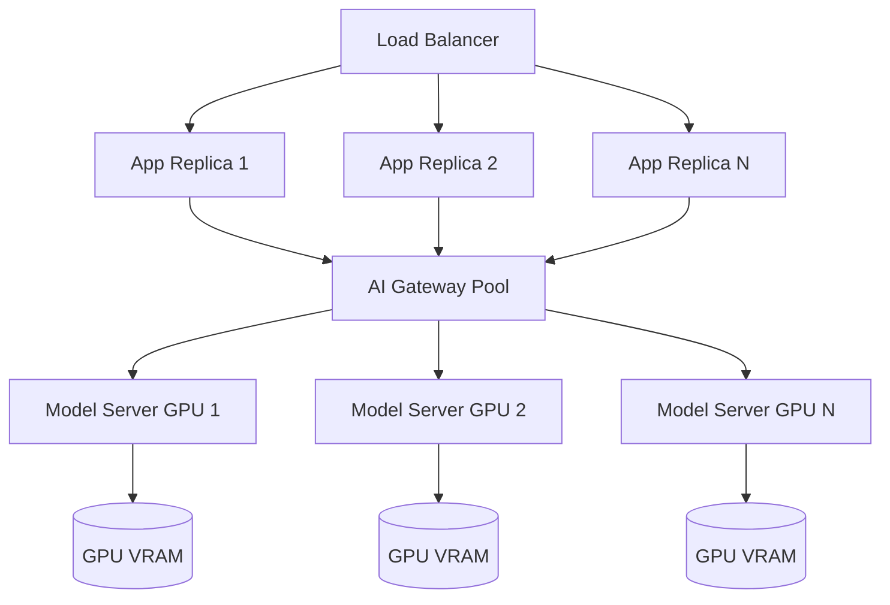
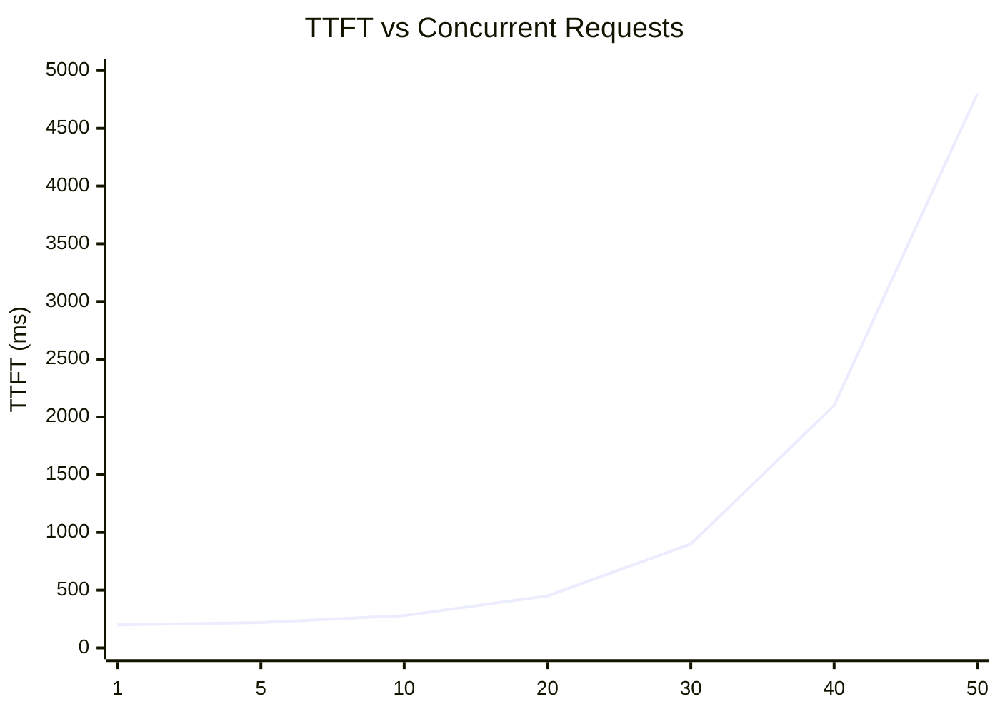

# Module 15 Architecture

## End-to-End Latency Waterfall

```
Total latency = 
  [1] network: client → gateway              ~5-20ms
  [2] gateway: auth, routing, request prep   ~5-15ms
  [3] network: gateway → model server        ~1-5ms
  [4] model queue wait                        0ms to ∞ (under load)
  [5] prefill (processing input tokens)       50-500ms (scales with prompt length)
  [6] time to first token (TTFT)              ↑ above + scheduling overhead
  [7] generation (output tokens / tok/s)      100ms to 10s (scales with output length)
  [8] network: model server → gateway        ~1-5ms
  [9] gateway: response assembly             ~1-5ms
  [10] network: gateway → client             ~5-20ms
```

## Scaling Topology



## KV Cache Memory Pressure Under Concurrency



TTFT is stable at low concurrency. Once KV cache pressure builds (typically at 70-80% memory), queuing begins and TTFT degrades non-linearly.

## Autoscaling Architecture (KEDA)

```mermaid
flowchart LR
    Metrics[Prometheus Metrics\nvllm_num_requests_waiting] --> KEDA[KEDA ScaledObject]
    KEDA --> HPA[Kubernetes HPA]
    HPA --> Serving[Model Serving Deployment]
    Serving --> GPU1[GPU Pod 1]
    Serving --> GPU2[GPU Pod 2]
    Serving --> GPU3[GPU Pod 3 (new)]
```
