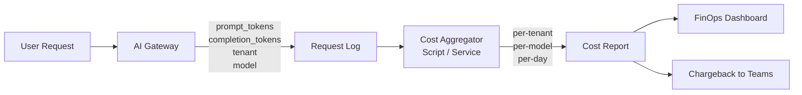
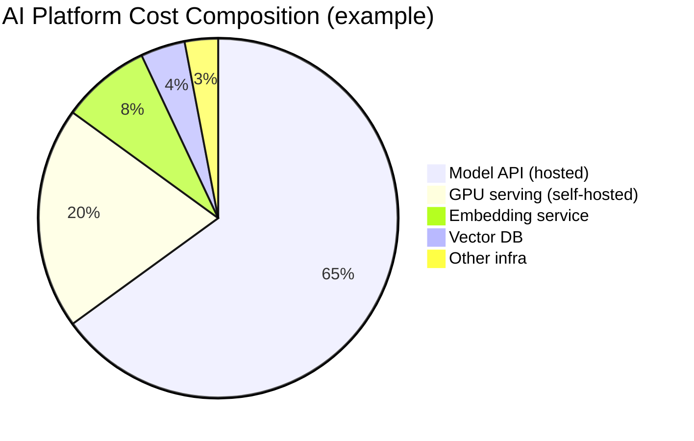
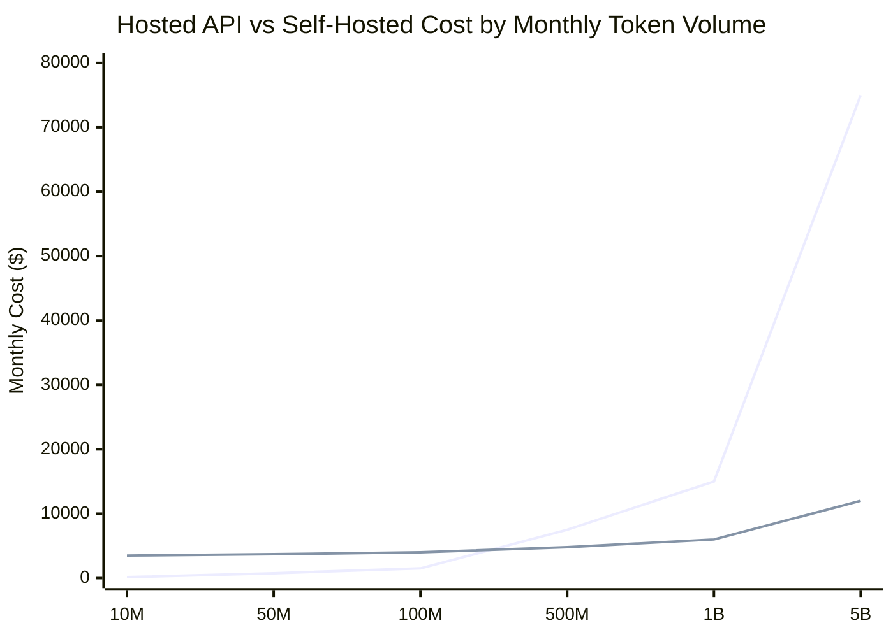
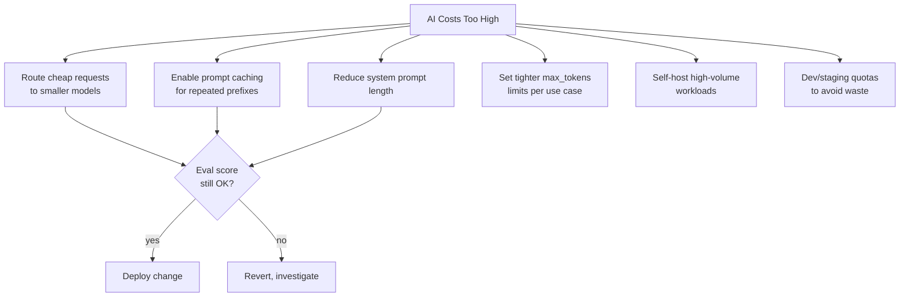

# Module 16 Architecture

## Cost Attribution Flow

## Cost Composition

## Break-Even Analysis

Note: hosted API cost scales linearly with tokens; self-hosted has fixed hardware cost plus small variable cost. Break-even is typically 100M–500M tokens/month for common model tiers.

## Cost Optimization Levers

