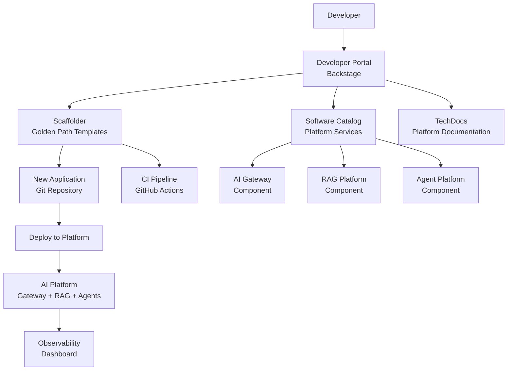

# Module 17 Architecture

## Developer Platform Layer Over AI Platform



## Self-Service Journey

```mermaid
flowchart LR
    Need[Developer has\na new AI use case] --> Portal[Visit developer portal]
    Portal --> Browse[Browse platform\ncapabilities]
    Browse --> Template[Pick a golden\npath template]
    Template --> Config[Fill in app name,\ntenant, model tier]
    Config --> Scaffold[Scaffolder creates\ngit repo + CI pipeline]
    Scaffold --> Test[Developer tests\nlocally]
    Test --> PR[Open PR → CI\nevals green]
    PR --> Deploy[Deploy to staging\nthen production]
    Deploy --> Use[Application calling\nplatform services]
```



## Backstage Component Relationships

```mermaid
graph LR
    NewApp[new-rag-app\nComponent] -- dependsOn --> GW[ai-gateway\nAPI]
    NewApp -- dependsOn --> RAG[rag-platform\nAPI]
    GW -- providesAPI --> GWEndpoint[/api/chat\nEndpoint]
    RAG -- providesAPI --> RAGEndpoint[/api/query\nEndpoint]
    GW -- ownedBy --> PlatformTeam[Platform Team]
    RAG -- ownedBy --> PlatformTeam
    NewApp -- ownedBy --> TeamA[Team A]
```

## Platform API Versioning

```mermaid
flowchart LR
    v1[/api/v1/chat\nStable] --> Apps1[All current apps]
    v2[/api/v2/chat\nCurrent] --> Apps2[New apps + opted-in apps]
    v3[/api/v3/chat\nBeta] --> Apps3[Early adopters only]

    v1 -- "12-month deprecation\nnotice before removal" --> v1end[EOL notice sent]
```
