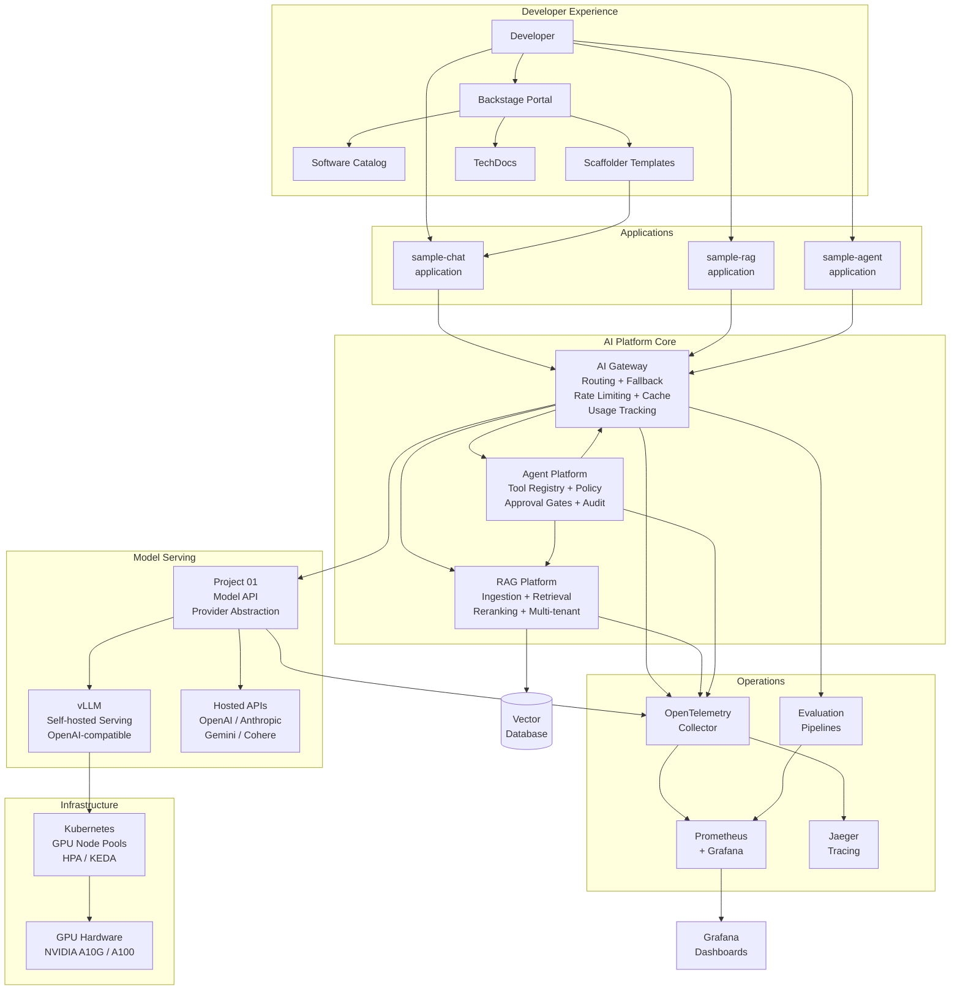
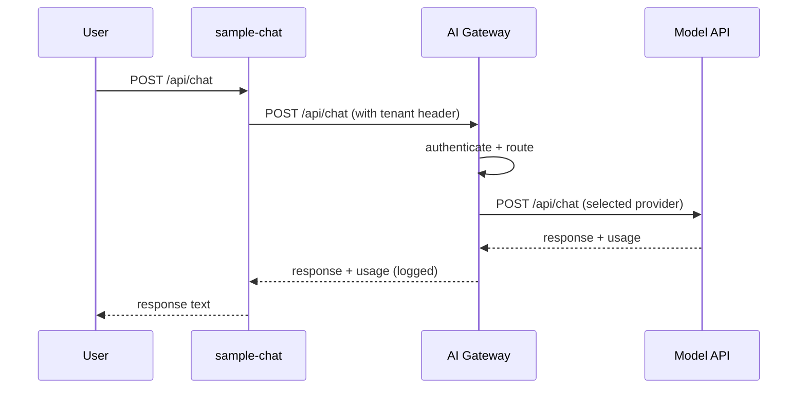
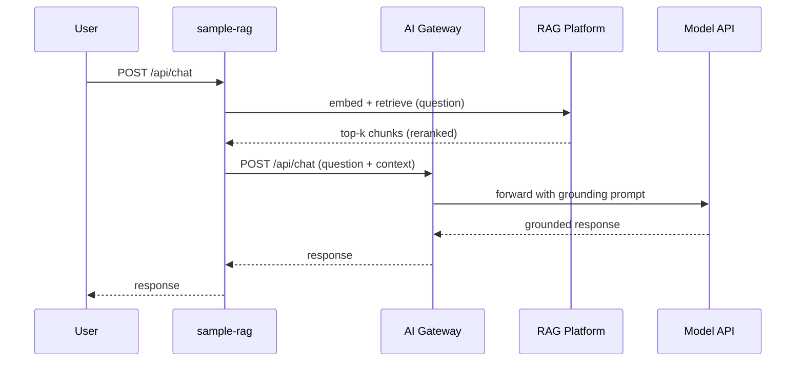
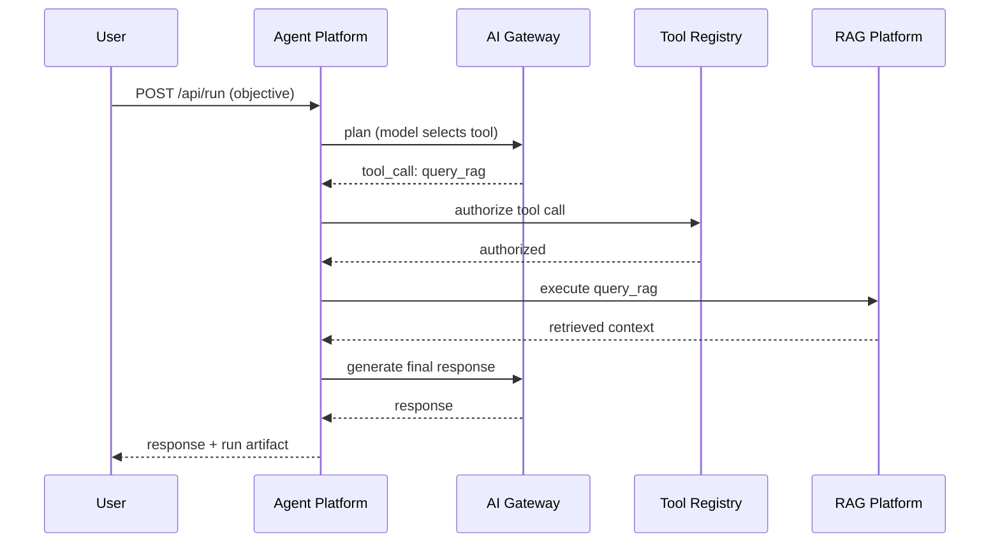

# Final AI Platform — Reference Architecture

## Complete Platform Diagram



## Request Flow Diagrams

### Simple Chat Request



### RAG-Augmented Request



### Agent Tool Execution



## Component Ownership Map

| Component | Owner | Consumers |
|---|---|---|
| AI Gateway | Platform Team | All application teams |
| RAG Platform | Platform Team | Application teams, Agent Platform |
| Agent Platform | Platform Team | Application teams |
| Model API (Project 01) | Platform Team | Gateway, direct consumers |
| Model Serving (vLLM) | Platform Team | Model API |
| Evaluation Pipelines | Platform Team + App Teams | CI/CD, Observability |
| Application Templates | Platform Team | Application teams (read-only consumers) |
| Backstage Catalog | Platform Team | All developers |

## Environment Architecture

```
dev           → local Docker Compose stacks, mock providers, cheap model tier
staging       → Kubernetes (kind/k3d), real providers, cheap model tier
production    → Kubernetes (cloud), real providers + self-hosted, tiered routing
```
