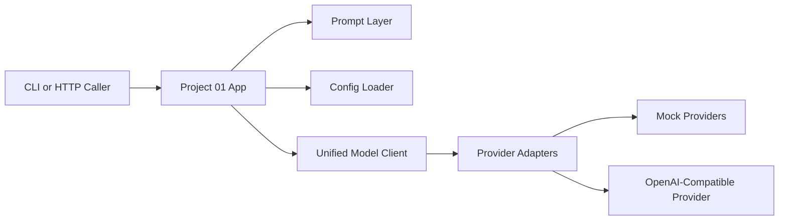
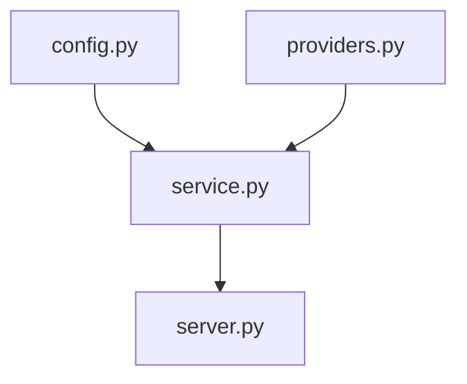

# Project 01 Architecture

## Application View



## Local HTTP API View

```mermaid
flowchart LR
    User[Caller] --> API[/api/chat]
    API --> Service[UnifiedModelClient.chat]
    Service --> Provider[Selected Provider Adapter]
    Provider --> Result[Normalized Result]
    Result --> RunArtifact[Saved JSON Artifact]
```

## Internal Separation



## What To Notice

- config loading is separate from provider transport
- provider selection is explicit and named
- the same unified client can power both CLI and HTTP entry points
- mock providers make local validation easy before any real API key exists